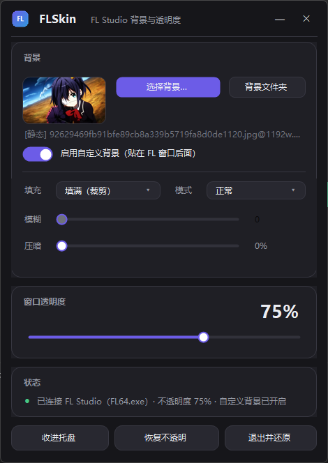
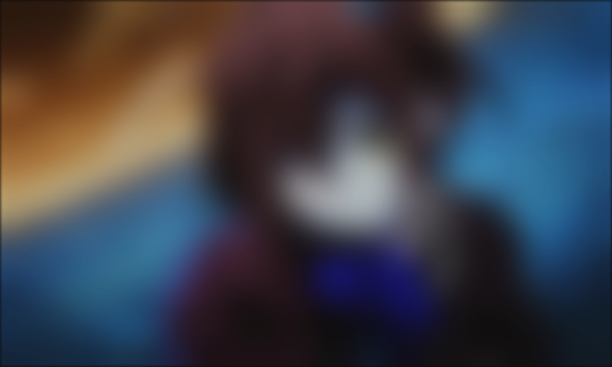
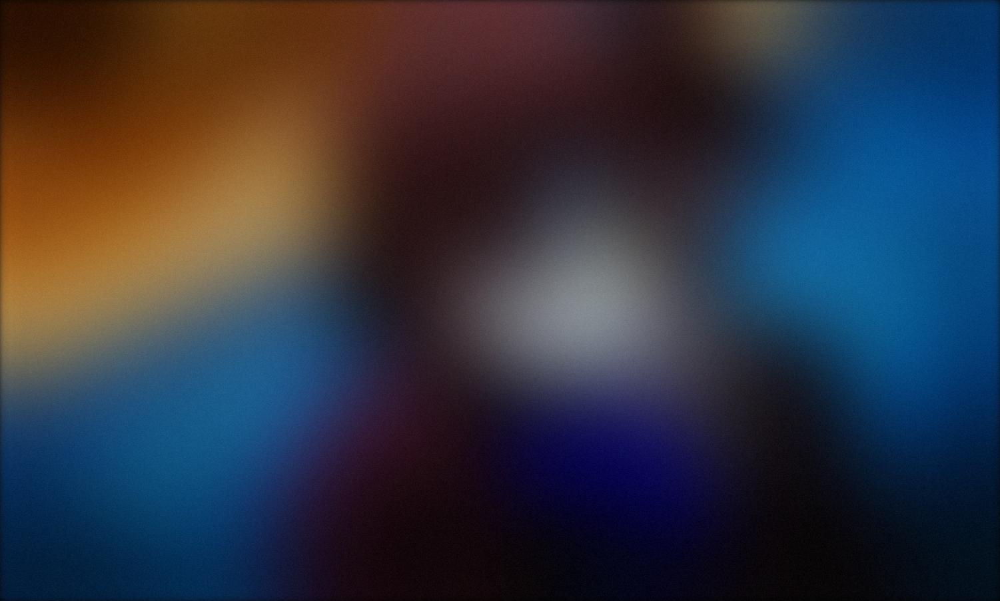

# FLSkin · 给 FL Studio 加「自定义背景 + 窗口透明度」

> 实测环境：FL Studio 2026 (25.2) / Windows 11 22621 / .NET 9
> 版本：1.12.0

FL Studio 是闭源软件，本体没有背景图功能，也不能调窗口透明度。FLSkin 不改 FL 的任何文件、不注入 DLL，
而是用 Windows 自带的窗口合成能力从外部实现这两件事：

1. **窗口透明度**：给 FL 主窗口加上分层窗口标记（`WS_EX_LAYERED` + `SetLayeredWindowAttributes`），
   DWM 合成时按百分比与下层内容混合。
2. **自定义背景**：另建一个无边框、不进任务栏、不抢焦点的背景窗口，贴在 FL 主窗口**正下方**。
   FL 变透明后，这一层就透出来 —— 看起来就像 FL 自己有了背景图 / 背景视频。

实测：设 39% 不透明度时，屏幕像素与「FL 内容 × 0.39 + 背景 × 0.61」的理论值平均误差约 1/255，
是真的按 alpha 合成，不是滤镜糊上去的。



## 使用场景

- **给 DAW 换个氛围**：把自己的壁纸、角色图铺在 FL 后面，配「玻璃模糊 / 亚克力」模式，界面像浮在磨砂玻璃上。
- **直播 / 录屏**：把 FL 窗口调到 60–80% 不透明，画面里能透出壁纸或动态视频，比纯黑界面好看得多。
- **动态壁纸联动**：拿 Wallpaper Engine 里的 mp4 当背景，FL 一开就是动态背景（默认静音、循环播放）。
- **多工程 / 多显示器**：同时开两个 FL，各自一份透明度和背景层，互不影响；关掉一个自动回收。
- **讲解 / 演示**：临时把不透明度拉高、压暗背景，让观众注意力回到你正在操作的窗口上。

## 快速开始

1. 把 `FLSkin.exe`、`README.md`、`LICENSE` 放在同一个目录（例如 `D:\FL Skin\`）；
2. 双击运行，托盘会出现图标，同时弹出设置窗口；
3. 点「选择背景…」从背景库里挑一张图或一段视频，拖「不透明度」滑块到 60–85%；
4. 点「收进托盘」，之后 `Ctrl+Alt+S` 随时呼出，`Ctrl+Alt+↑/↓` 调透明度。

## 功能

| 功能 | 说明 |
| --- | --- |
| 背景库 | 专用文件夹 `D:\FL Skin\Backgrounds`，弹窗里按缩略图挑，标着 `[静态] 文件名` / `[动态] 文件名`，路径可改 |
| 静态背景 | PNG / JPG / BMP / GIF / WebP |
| 动态背景 | MP4 循环播放（也支持 m4v / mov / wmv / avi），默认静音，FL 隐藏时自动暂停 |
| 质感 | 正常 / 玻璃模糊 / 亚克力（模糊 + 提饱和 + 冷调 + 颗粒），强度 0–100 |
| 压暗 | 0–80%，实时（绘制时叠一层，不重算模糊） |
| 窗口透明度 | 30–100%，拖动时逐帧生效，FL 的淡入淡出是连续的 |
| 自动跟随 | WinEvent 事件驱动，FL 一动就贴回去（实测跳变 120px 后 1–3 ms 归位） |
| 多开支持 | 同时开多个 `FL64.exe` 实例，每个主窗口一份透明度 + 一份背景层 |
| 动画 | 窗口淡入淡出、开关滑动、按钮/卡片悬停渐变，共用一条时间轴，空闲 0% CPU |
| 托盘 / 热键 | 关掉窗口不退出；`Ctrl+Alt+↑/↓` 透明度、`Ctrl+Alt+B` 背景、`Ctrl+Alt+S` 设置 |

## 背景库

默认目录：`D:\FL Skin\Backgrounds`（没有 D 盘时退回 `图片\FLSkin`）。

点「选择背景…」打开背景库窗口：缩略图网格、`[静态]` / `[动态]` 标注、单击选中、双击直接应用；
左下角「打开文件夹」「更改文件夹…」可以换目录（会记进配置）。

## 动态背景（MP4）

用 WPF `MediaElement`（底层 Media Foundation）解码，硬件加速，1920×1032 全屏播放时进程 CPU 约 0.6%。
播完自动从 0 秒重播；文件损坏或编码不支持（比如没装 HEVC 扩展的 H.265）会自动退回静态图并在状态栏提示。

## 三种静态模式

| 正常 | 玻璃模糊 | 亚克力 |
| --- | --- | --- |
|  |  |  |

## 热键(我不知道有没有用，没试过)

| 热键 | 作用 |
| --- | --- |
| `Ctrl+Alt+↑` / `Ctrl+Alt+↓` | 不透明度 ±5% |
| `Ctrl+Alt+B` | 背景开关 |
| `Ctrl+Alt+S` | 显示设置窗口 |

## 常见问题

**背景没出来 / 只有透明度生效**
FL 是不是以管理员身份运行的？Windows 不允许普通权限进程把窗口排到高权限窗口正下方。
关掉 FL 用普通方式启动，或右键 FLSkin →「以管理员身份运行」。

**FL 独占全屏时无效**
独占全屏绕过 DWM 合成，透明度不生效。用普通最大化窗口。

**多显示器 / 高 DPI**
程序按 PerMonitorV2 声明 DPI 感知，坐标用物理像素，多屏和 125% / 150% 缩放都正常。

**同时开了两个 FL Studio**
支持，按主窗口类名找到每个实例，各自一份透明度和背景层。

**退出后 FL 还是半透明？**
点「退出并还原」或托盘菜单里的同名项；就算程序被强杀，FL 下次重启也会回到不透明。

## 构建

需要 .NET 9 SDK：

```powershell
.\build.ps1
# 产物：dist\FLSkin.exe（框架依赖，需要 Microsoft.WindowsDesktop.App 9.x）
# README.md / LICENSE 也会一并复制到 dist
```

## 目录

```
flskin/
├─ dist/                 # 编译产物（含 README.md、LICENSE）
├─ docs/                 # 截图
├─ src/FLSkin/
│  ├─ Program.cs         # 入口 + 单实例
│  ├─ AppController.cs    # 主循环：找窗口、套透明度、贴背景、托盘、热键
│  ├─ FlStudio.cs        # FL 窗口定位 / 透明度
│  ├─ BackdropForm.cs    # 背景窗口：静态图渲染（后台算）+ MP4 播放
│  ├─ ImageEffects.cs    # 模糊 / 饱和 / 叠色 / 颗粒
│  ├─ WinEventWatcher.cs # 窗口移动 / 缩放 / 激活事件钩子
│  ├─ SettingsForm.cs    # 设置界面
│  ├─ BackgroundPickerForm.cs / Ui/BackgroundTile.cs  # 背景库
│  ├─ AboutForm.cs / TextViewerForm.cs                # 关于 / 文档查看
│  ├─ Ui/                # 自绘控件、主题、动画
│  ├─ AppConfig.cs       # 配置读写
│  └─ Native.cs          # Win32 互操作
├─ build.ps1
├─ LICENSE
└─ 启动 FLSkin.cmd
```

## 许可

本软件以 **MIT License** 发布，见 [LICENSE](LICENSE)。你可以自由使用、修改、再分发，保留版权与许可声明即可。

本软件与 Image-Line 无关，不包含 FL Studio 的任何代码或资源。
